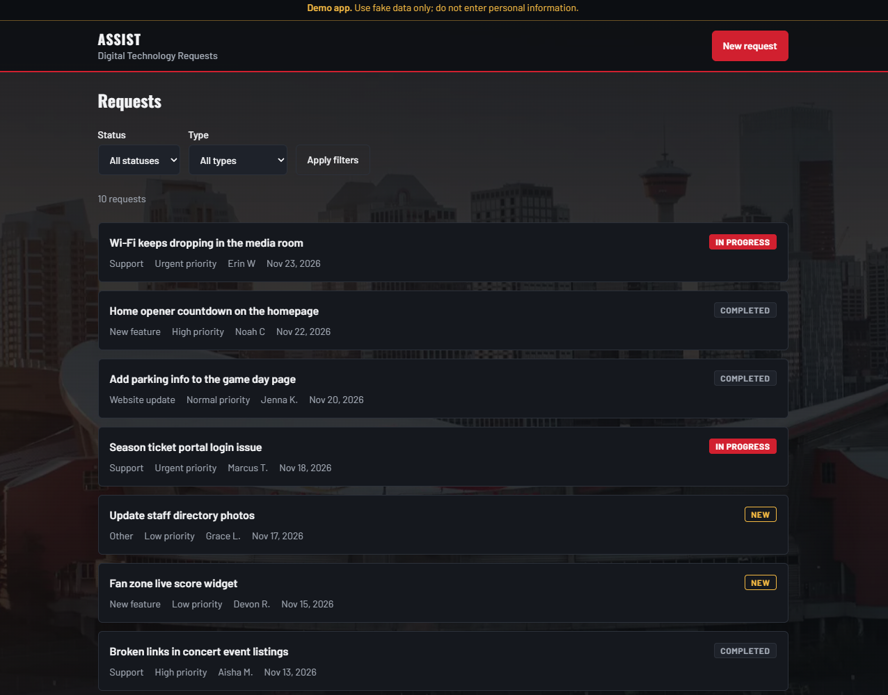

# Assist

**An internal request desk for a Digital Technology team.** Staff submit requests, the team works through them, and every status change is kept as history.

[](https://github.com/N-Crossman/Internal-Request-System/actions/workflows/ci.yml)

**Live demo:** [assist.noahh.dev](https://assist.noahh.dev) · **Repo:** [github.com/N-Crossman/Internal-Request-System](https://github.com/N-Crossman/Internal-Request-System)



> The live site is a public demo with no sign-in. Please use demo data only.

---

## Contents

- [Features](#features)
- [Tech stack](#tech-stack)
- [Architecture](#architecture)
- [Data model](#data-model)
- [Getting started](#getting-started)
- [Testing and CI](#testing-and-ci)
- [Deployment](#deployment)
- [Decisions and trade-offs](#decisions-and-trade-offs)
- [How I used AI](#how-i-used-ai)
- [What I would do next](#what-i-would-do-next)
- [Credits and licence](#credits-and-licence)

---

## Features

- **Submit a request:** give a title, description, type (Support, Website update, New feature, Other), priority (Low, Normal, High, Urgent) and your name. It's checked on the server, and any errors appear next to the field they belong to.
- **Browse and filter requests,** newest first. Filters for status and type are kept in the URL, so a filtered view can be bookmarked or shared.
- **View a request** with its full details and a timeline of every status change.
- **Change the status** between New, In progress and Completed. Each change is saved together with a history entry, as a single step.
- **Loading, error and not-found states** for every page. Forms are accessible: labeled fields, linked error messages, and visible focus.
- **Responsive, always-dark theme** that works on phones, tablets and desktops.

## Tech stack

| Layer       | Choice                                            | Why                                                                                                                                                |
| ----------- | ------------------------------------------------- | -------------------------------------------------------------------------------------------------------------------------------------------------- |
| Framework   | **Next.js 16** (App Router), React 19, TypeScript | Pages and server logic live in one codebase. Server Components read the database directly, and Server Actions handle forms without a separate API. |
| Database    | **PostgreSQL 18** on **Neon**                     | Real relational data with foreign keys, enums and transactions. Neon is a managed Postgres with a free tier, so it's standard SQL with no lock-in. |
| Data access | **Drizzle ORM**                                   | Type-safe queries that still read like SQL. The schema is plain TypeScript, and every migration is a SQL file kept in git.                         |
| Validation  | **Zod**                                           | One schema checks input on the server and provides the TypeScript types.                                                                           |
| Styling     | **Tailwind CSS**                                  | Colours and fonts are defined once in CSS as design tokens. Contrast was checked for readability.                                                  |
| Testing     | **Node's built-in test runner** via `tsx`         | Has no extra dependencies. See [How I used AI](#how-i-used-ai) for why this replaced Vitest.                                                       |
| CI          | **GitHub Actions**                                | Lint, typecheck, unit and integration tests against a real Postgres 18, then a production build on every PR.                                       |
| Hosting     | **Vercel** (Portland, `pdx1`)                     | Runs in the same region as the Neon database (`us-west-2`), so database queries don't have to travel far and load quickly.                         |

## Architecture

```
Browser
  │  HTML (Server Components)          form posts (Server Actions)
  ▼                                    ▼
src/app/**/page.tsx               src/app/actions.ts
  │                                    │  validate with Zod (src/lib/validation.ts)
  │                                    │  revalidatePath + redirect
  └──────────────┬─────────────────────┘
                 ▼
         src/lib/requests.ts      ← the only module that talks to the database
                 │  Drizzle ORM, transactions
                 ▼
         src/db (schema)  →  PostgreSQL
```

- **A single data layer.** Every query lives in [`src/lib/requests.ts`](../src/lib/requests.ts). Pages, Server Actions and the integration tests all call the same functions, so every query the app runs is tested.
- **Validate at the edge, trust inside.** Server Actions parse form data with Zod before anything reaches the data layer. Invalid input comes back to the form with an error for each field, and the values the user typed are kept.
- **Status changes are atomic.** `updateStatus` runs in a transaction and locks the row with `SELECT … FOR UPDATE`. That way, two people changing the same request at the same moment are handled one after the other, and the request's status and its history can never disagree.
- **The URL holds the list state.** The list page reads `status` and `type` from the query string and ignores invalid values. The filter form is a plain GET form, so it works even without JavaScript.
- **Dynamic data is streamed.** The app uses `cacheComponents`. Database reads happen inside `<Suspense>`, so the header and layout appear immediately and a loading message shows while the data arrives.

### Project layout

```
src/
  app/
    page.tsx                 request list + filters
    requests/new/            new request form (client form, server action)
    requests/[id]/           detail page, status form, history timeline
    actions.ts               Server Actions (create, update status)
    layout.tsx, globals.css  shell, fonts, theme tokens
    loading/error/not-found  route states
  components/status-badge.tsx
  db/
    schema.ts                tables, enums, indexes
    index.ts                 Postgres connection
    seed.ts                  insert-only demo data
  lib/
    requests.ts              data layer
    validation.ts            Zod schemas
    constants.ts             types, statuses, priorities, labels, limits
    format.ts                dates in Mountain Time (America/Edmonton)
    *.test.ts                unit + integration tests
drizzle/                     generated SQL migrations
```

## Data model

```
requests                                   status_history
──────────────────────────────             ─────────────────────────────────
id             uuid  PK                    id           uuid  PK
title          varchar(120)                request_id   uuid  FK → requests.id  (on delete cascade)
description    text                        from_status  request_status  (null for the first entry)
type           request_type                to_status    request_status
status         request_status = 'new'      changed_at   timestamptz
priority       request_priority = 'normal'
requester_name varchar(100)
created_at     timestamptz
updated_at     timestamptz
```

- **Enums in the database** (`request_type`, `request_status`, `request_priority`) mean bad values are rejected by Postgres itself, not just by the app. The same lists live in [`src/lib/constants.ts`](../src/lib/constants.ts) and feed the schema, Zod and the UI.
- **History is its own table** rather than a JSON column, so it can be queried, ordered and indexed. Creating a request writes the first history row (`null → new`) in the same transaction.
- **Indexes** on `requests.status`, `requests.type` and `status_history.request_id` cover the filters and the detail page.
- **Length limits** come from shared constants. The Zod schemas and the form fields enforce them, and the database enforces them again for `title` and `requester_name` through `varchar`.

## Getting started

**Prerequisites:** Node.js 22 or newer, and a PostgreSQL database. You can use the included Docker Compose file or a free [Neon](https://neon.tech) project.

```bash
git clone https://github.com/N-Crossman/Internal-Request-System.git
cd Internal-Request-System
npm install
cp .env.example .env
```

**Choose a database:**

- **Docker (local):** `docker compose up -d` starts Postgres 18 on port **5433**, so it won't clash with a local Postgres on 5432. The default `.env.example` value already points to it.
- **Neon (hosted):** create a project and set `DATABASE_URL` in `.env` to its connection string.

**Create the tables, add demo data and start the app:**

```bash
npm run db:migrate   # apply the SQL migrations in drizzle/
npm run db:seed      # add 8 example requests (skipped if requests already exist)
npm run dev          # http://localhost:3000
```

### Scripts

| Script                        | What it does                                                                |
| ----------------------------- | --------------------------------------------------------------------------- |
| `npm run dev`                 | Start the development server                                                |
| `npm run build` / `npm start` | Production build and server. The build doesn't need a database.             |
| `npm run lint`                | ESLint                                                                      |
| `npm run typecheck`           | Generate Next.js route types, then `tsc --noEmit`                           |
| `npm test`                    | Run unit tests. Integration tests also run when `TEST_DATABASE_URL` is set. |
| `npm run db:generate`         | Create a new migration after changing `src/db/schema.ts`                    |
| `npm run db:migrate`          | Apply migrations to `DATABASE_URL`                                          |
| `npm run db:seed`             | Insert demo data. It never deletes anything.                                |

## Testing and CI

**Unit tests** ([`validation.test.ts`](../src/lib/validation.test.ts), 12 tests) cover the Zod schemas: required fields, trimming, length limits, unknown enum values, the default priority and malformed ids.

**Integration tests** ([`requests.integration.test.ts`](../src/lib/requests.integration.test.ts), 7 tests) run the real data layer against a real Postgres. They cover:

- creating and reading a request with its first history entry
- changing status, then reopening a completed request
- rejecting a change to the same status, and handling a missing id
- combined filters
- **transaction rollback:** a temporary trigger makes the history insert fail, and the test proves the status change was rolled back too

The integration tests empty the tables before each test, so they have safety rails:

- They only run when `TEST_DATABASE_URL` is set, and are skipped otherwise.
- They refuse to run at all if that URL points at Neon, so they can never wipe the live database.

**CI** ([`.github/workflows/ci.yml`](../.github/workflows/ci.yml)) runs on every pull request and every push to `main`. It starts a throwaway `postgres:18` service container, then runs, in order:

1. npm ci
2. lint
3. typecheck
4. migrations
5. all 19 tests
6. a production build

`main` is protected by a ruleset: changes go through pull requests, history stays linear, and PRs are rebase-merged after CI passes.

## Deployment

- **Vercel** builds and deploys `main` automatically. The function region is set to Portland (`pdx1`) to sit next to the Neon database in `us-west-2`.
- **Neon** holds the single production database. Vercel uses Neon's **pooled** connection string, which suits serverless functions that open many short connections.
- `DATABASE_URL` is set for the **Production** environment only. Preview deployments have no database, so a branch preview can never read or change live data.
- The database connection is created on first use, not when the app loads, so `next build` works without any secrets.
- **Custom domain:** `assist.noahh.dev` is a CNAME to Vercel, managed at the domain's DNS provider.
- **Cold start:** Neon's free tier suspends the database when idle, so the first request after a quiet period can take a second or two.

## Decisions and trade-offs

The brief valued approach over feature count, so I kept the scope deliberately small and made each piece solid. Some things I chose **not** to build:

| Left out                               | Why                                                                                                                                                                                                                                                                                                  |
| -------------------------------------- | ---------------------------------------------------------------------------------------------------------------------------------------------------------------------------------------------------------------------------------------------------------------------------------------------------- |
| **Sign-in and roles**                  | Out of scope for the brief. Instead, the live site shows a banner asking visitors to use made-up data only. In production this would use the organisation's SSO (see below).                                                                                                                         |
| **Deleting requests**                  | Not in the requirements, and on a public site with no sign-in it would let anyone wipe data. Internal tools usually close or archive rather than delete. Here, **Completed** does that and keeps the history. The `on delete cascade` foreign key means deleting is a small change once roles exist. |
| **Summary/count cards**                | The status filter already answers "how many are in progress?". I preferred fewer, well-tested queries over extra dashboard features.                                                                                                                                                                 |
| **Security headers and rate limiting** | Worth adding for a real deployment (listed below), but for a short-lived demo I prioritised features I could test and explain fully. Server-side validation and parameterised queries (Drizzle never puts values into the SQL text) protect against SQL injection.                                   |
| **Email field**                        | No notifications exist to use it, so collecting it would only gather personal data for no reason.                                                                                                                                                                                                    |

## How I used AI

I used an AI coding assistant (Claude Code) throughout, as a pair programmer.

I owned the plan and the review. The work was split into eight small steps, each on its own branch with small, focused commits and a pull request. I read and committed every change myself, and cut anything I couldn't justify. That's where several of the decisions above came from.

Three places where I steered the AI's suggestions:

1. **Colour tokens instead of one-off styling.** The AI wanted to give every file its own specific colour values. Instead, we defined the colours once as design tokens in [`src/app/globals.css`](../src/app/globals.css) and used named classes such as `bg-flame`, `text-gold` and `border-line` everywhere. A rebrand is now a one-file change, and the contrast only had to be checked once.
2. **Vitest.** The AI was set on using Vitest, but it failed on every test on my Windows/Node 22 setup, and downgrading it crashed npm. Rather than spend the time on tooling, I switched to Node's built-in test runner. It has no dependencies, and the tests barely changed.
3. **A delete feature.** The AI naturally wanted to add a delete feature, as most request tools have one. But this is a live site with no sign-in or role permissions, so anyone who loaded it could delete all the existing data, so I left it out.

## What I would do next

**Before real users**

- Sign-in through the organization's identity provider and roles: requesters see their own requests, and the Digital Technology team can change status and delete.
- Security headers, plus rate limiting on the form.
- Automated database backups and a restore test, with a separate staging database.
- Audit fields: who changed the status, not just when.

**Product**

- Comments on a request, assignment to a team member, and email or Teams notifications.
- File attachments, so requesters can include screenshots of a bug or the page they want changed.

**Path to production on a cloud the team already uses**

The app is a standard Node server talking to standard Postgres, so it can move to another provider with few changes:

| Concern             | AWS                           | Azure                         |
| ------------------- | ----------------------------- | ----------------------------- |
| App                 | App Runner / ECS              | App Service / Container Apps  |
| Database            | RDS or Aurora PostgreSQL      | Azure Database for PostgreSQL |
| Secrets             | Secrets Manager               | Key Vault                     |
| Sign-in             | IAM Identity Center / Cognito | Entra ID                      |
| Logs and monitoring | CloudWatch                    | Application Insights          |

## Credits and licence

- **Background photo:** the Scotiabank Saddledome and downtown Calgary, by **Patrik Jensen** on [Unsplash](https://unsplash.com/photos/an-aerial-view-of-a-stadium-with-a-city-in-the-background-_QOR7cwVDik), free to use under the [Unsplash License](https://unsplash.com/license).
- **Fonts:** [Oswald](https://fonts.google.com/specimen/Oswald) and [Barlow](https://fonts.google.com/specimen/Barlow), both under the SIL Open Font License 1.1, served locally through `next/font`.
- **Licence:** all rights reserved. The code may be viewed and run for evaluation only. See [LICENSE](../LICENSE).

**Trademark disclaimer:** Assist is an independent portfolio project. It is not affiliated with, endorsed by, or sponsored by Calgary Sports and Entertainment Corporation or the Calgary Flames. The colours are only inspired by the team; no logos or official assets are used.
